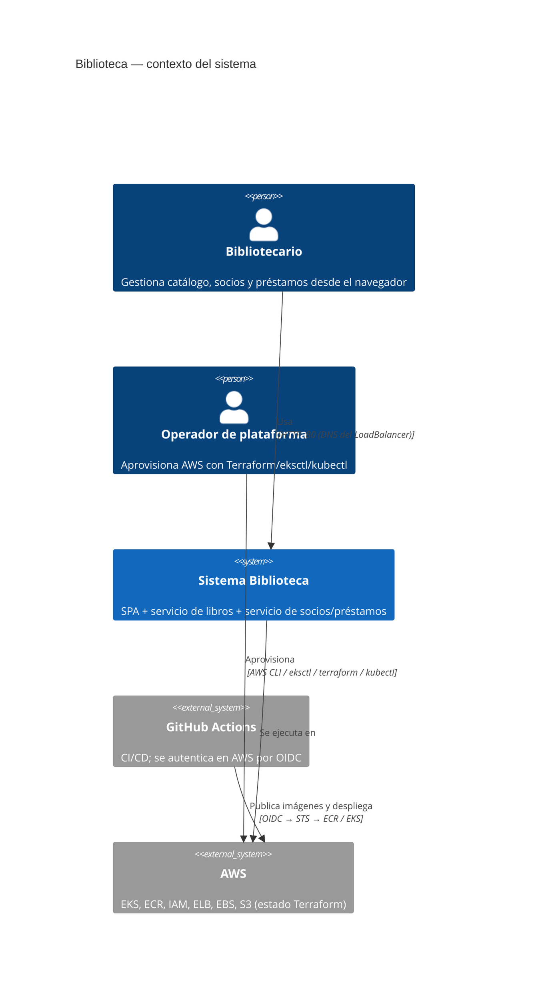
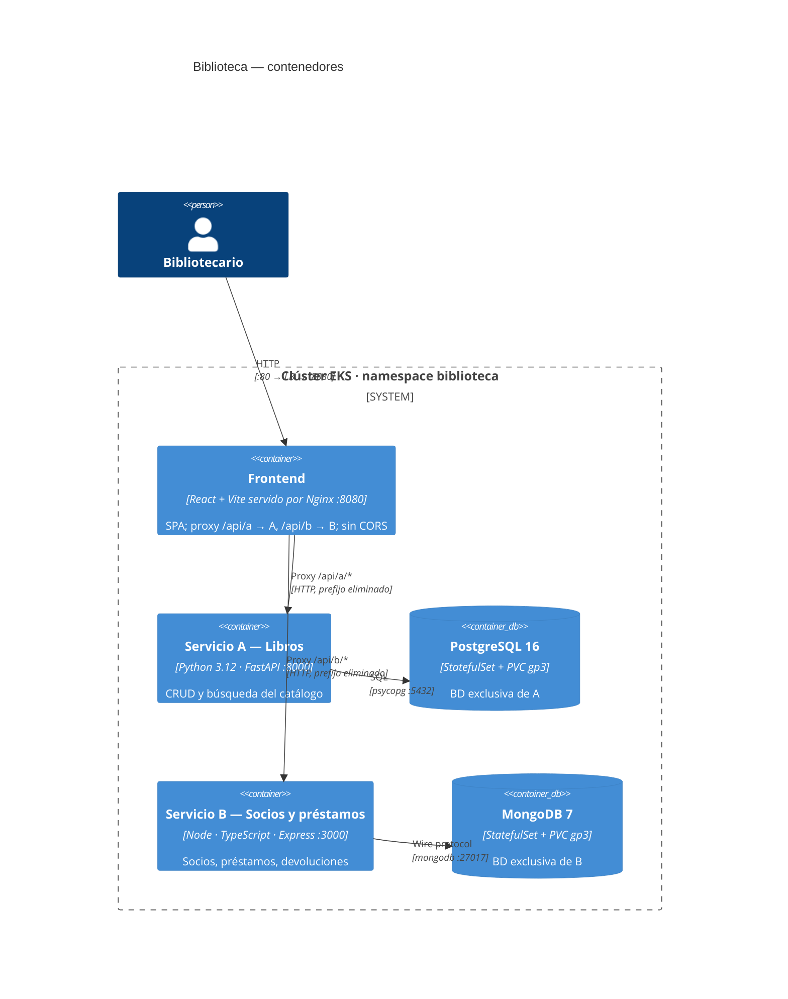
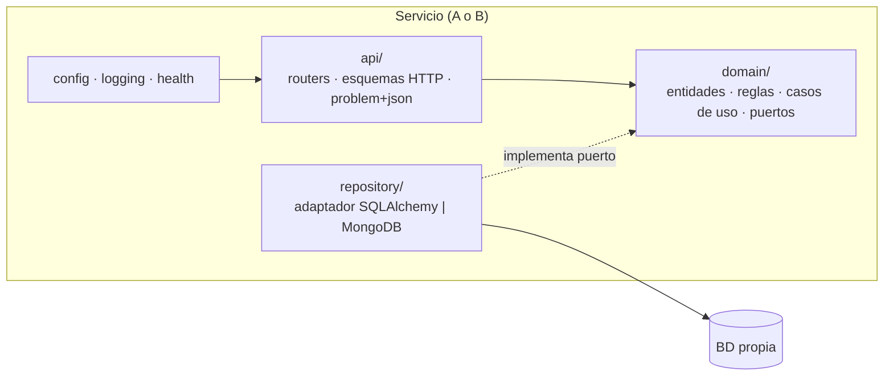
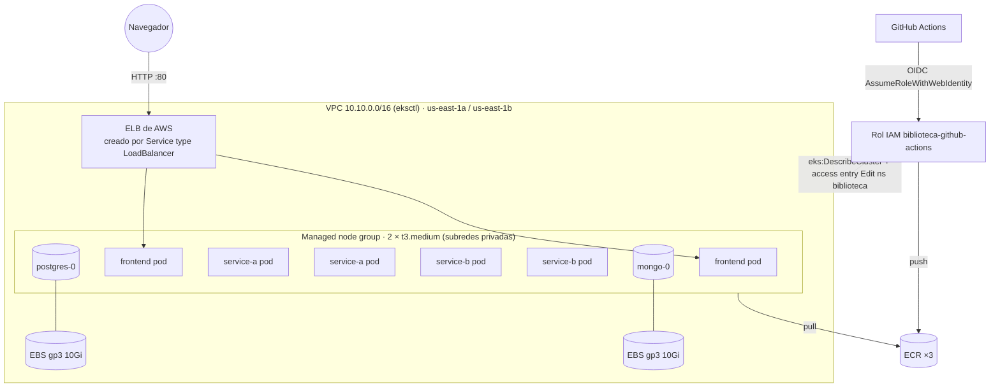
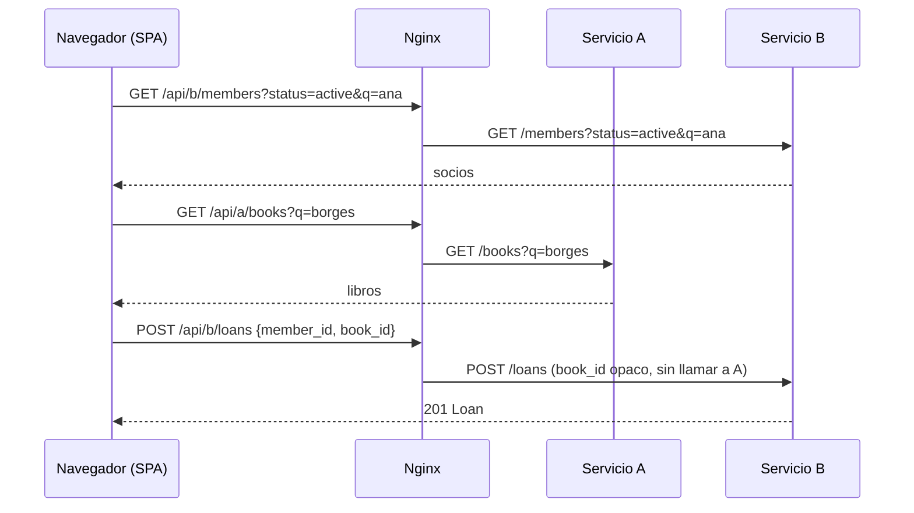

# Arquitectura (modelo C4)

> Fuente: [specs/000-sistema](../specs/000-sistema/spec.md) y [specs/004-plataforma](../specs/004-plataforma/spec.md).
> Decisiones: [docs/adr](adr/README.md).

## Nivel 1 — Contexto

## Nivel 2 — Contenedores

**Invariante**: no existe ninguna flecha A ↔ B ni A → MongoDB ni B → PostgreSQL (REQ-SYS-002,
NetworkPolicies REQ-P-018). La composición (préstamo + título del libro) ocurre en el navegador.

## Nivel 3 — Componentes (ambos servicios siguen la misma forma)

`domain` no depende de frameworks (comprobado por pruebas de capas).

## Despliegue

## Flujo de una petición típica: "registrar préstamo"

