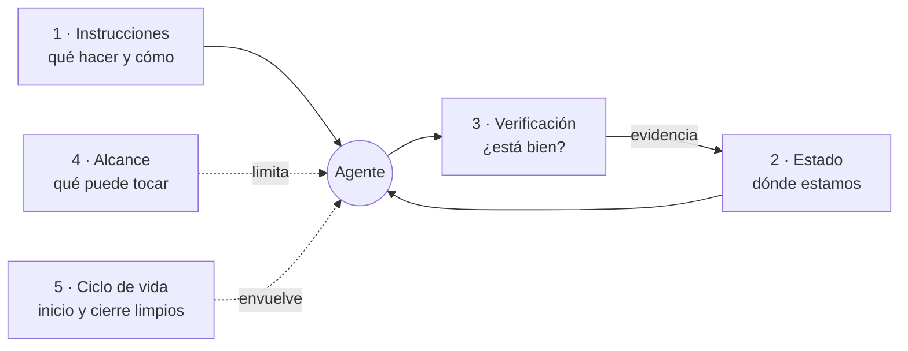

# Harness para agentes de IA

Un *harness* es el conjunto de archivos, scripts y hooks que rodea al agente para que trabaje de
forma fiable. Aquí se organiza en **5 subsistemas**. Cada uno existe para prevenir una clase concreta
de fallo del agente.



## 1. Instrucciones
| Archivo | Rol |
|---|---|
| [CLAUDE.md](../CLAUDE.md) · [AGENTS.md](../AGENTS.md) | Entrada corta (≤ 80 líneas): propósito, mapa, flujo, comandos, reglas duras, enlaces |
| [specs/constitution.md](../specs/constitution.md) | Principios no negociables |
| `specs/NNN-*/spec.md · plan.md · tasks.md · data-model.md · contracts/openapi.yaml` | Qué / cómo / en qué orden / contrato |
| `.claude/commands/` — `/spec`, `/plan`, `/tasks`, `/implement <TASK-ID>`, `/verify`, `/status` | Procedimientos paso a paso para cada fase SDD |
| `.claude/agents/` — `spec-reviewer`, `test-engineer`, `code-reviewer`, `platform-engineer` | Revisores/ejecutores especializados con herramientas limitadas |
| [docs/adr/](adr/README.md) | El porqué de las decisiones (evita re-litigarlas) |

**Fallos que previene**: el agente *inventa requisitos* o decide sobre ambigüedades (→ `[NEEDS CLARIFICATION]`
obligatorio); *se pierde en un archivo gigante* de instrucciones (→ entrada corta que enlaza, divulgación
progresiva); *salta fases* y escribe código sin spec/plan (→ flujo y comandos por fase); *contradice
decisiones previas* (→ constitución + ADRs); *se autoevalúa con indulgencia* (→ subagentes revisores sin permiso de escritura).

## 2. Estado
| Archivo | Rol |
|---|---|
| [feature_list.json](../feature_list.json) + `scripts/feature_list.schema.json` | Estado máquina: cada feature con `req_ids`, `steps`, `passes` (todas empiezan en `false`) |
| [PROGRESS.md](../PROGRESS.md) | Estado humano: Sesión / Fase / Hecho / En curso / Siguiente / Bloqueos / Decisiones (+ bloque automático) |
| `specs/*/tasks.md` | Casillas `[ ]`/`[x]` por tarea (las marca solo `make task-done`) |
| `.harness/current-task.json`, `.harness/last-verify.json` (no versionados) | Tarea activa y última evidencia de verificación (con huella del árbol) |
| git (Conventional Commits, commits pequeños con TASK-ID) | Historial auditable |

**Fallos que previene**: *amnesia entre sesiones* (cada sesión arranca leyendo PROGRESS + status);
*declarar victoria prematura* (`passes` solo cambia con `make feature-pass`, que exige tareas cerradas,
tests en verde y verify fresco); *reescribir la historia* para que cuadre (feature_list es append-only y
`check_feature_list.py` lo compara con git); *perder el hilo de qué sigue* (`status.py` calcula tareas listas por dependencias).

## 3. Verificación
| Archivo | Rol |
|---|---|
| `make verify` → [scripts/verify.py](../scripts/verify.py) | Única definición de "hecho": formato de tareas, feature_list, trazabilidad, contratos, lint, tipos, unit, integración, contrato por componente, pruebas transversales, `terraform fmt/validate/test`, kubeconform, `eksctl --dry-run`, gitleaks |
| [scripts/check_traceability.py](../scripts/check_traceability.py) | Falla si un test no referencia un REQ, si cita un REQ inexistente o si un REQ en alcance no tiene test |
| [scripts/check_contracts.py](../scripts/check_contracts.py) | OpenAPI 3.1 válido + reglas de la casa (health, problem+json, REQ en cada operación) |
| [scripts/check_feature_list.py](../scripts/check_feature_list.py) | Esquema + todo REQ con feature + append-only frente a git |
| [.pre-commit-config.yaml](../.pre-commit-config.yaml) | Formato, lint, gitleaks, checks del harness y Conventional Commits en cada commit |
| Hook **PostToolUse** → `.claude/hooks/post_edit.py` | Bucle rápido: formatea/lintea el archivo recién editado y devuelve errores al agente |
| Hook **Stop** → `.claude/hooks/stop.py` | No deja cerrar el turno con verify en rojo (si el árbol cambió) |
| [.github/workflows/ci.yml](../.github/workflows/ci.yml) | La misma verificación en CI, sin credenciales |

**Fallos que previene**: *"ya funciona"* sin evidencia (la palabra del agente no cuenta, solo el exit code);
*tests decorativos* o código sin test (trazabilidad bidireccional); *deriva del contrato*; *secretos filtrados*;
*romper algo lejano* al cambiar algo cercano (verify ejecuta todo). El TDD convive con "verify verde" mediante
fallos esperados estrictos ([ADR-0008](adr/0008-verificacion-incremental.md)).

## 4. Alcance
| Archivo | Rol |
|---|---|
| `scripts/task.py` (`make task-start / task-done / task-abort`) | **WIP = 1**: una tarea activa; `start` exige dependencias hechas; `done` rechaza archivos fuera de la lista de la tarea |
| Hook **PreToolUse** → `.claude/hooks/scope_guard.py` | Bloquea en tiempo real ediciones fuera de los `Archivos` de la tarea activa; sin tarea, bloquea código/infra/tests; pide aprobación humana para tocar el propio harness; deniega `.env` y credenciales |
| [.claude/settings.json](../.claude/settings.json) `permissions` | *allow*: make, npm, uv/pip, pytest, docker, compose, kubectl get/describe/logs, terraform fmt/validate/plan, eksctl get. *ask*: terraform apply/destroy, eksctl create/delete, kubectl apply/delete, git push, docker push. *deny*: leer/escribir `~/.aws/credentials` y `.env` reales |
| Sección **Fuera de alcance** en cada spec | Frontera explícita de lo que no se construye |

**Fallos que previene**: *scope creep* ("ya que estoy, refactorizo esto"); *trabajo a medias en paralelo*
que nunca se cierra; *acciones irreversibles o costosas* sin humano (crear/destruir EKS, push); *exfiltrar o
romper credenciales*; *debilitar el propio harness* para pasar la verificación.

## 5. Ciclo de vida
| Archivo | Rol |
|---|---|
| [init.sh](../init.sh) | Idempotente: (1) herramientas, versiones y `aws sts get-caller-identity`; (2) dependencias; (3) `--up` docker compose; (4) smoke de salud; (5) resumen de PROGRESS y próximas features. `--check` = solo verificación rápida |
| Hook **SessionStart** | Ejecuta `./init.sh --check`; su salida entra al contexto del agente |
| Hook **Stop** | verify + recordatorio de actualizar PROGRESS.md |
| `make end-session` → `scripts/end_session.py` | verify → bloque automático de PROGRESS.md → `docker compose down` → aviso de coste si el clúster EKS existe → exige árbol git limpio |

**Fallos que previene**: *arrancar a ciegas* en un entorno roto (falta una herramienta, credenciales caducadas);
*dejar basura* (contenedores, clúster encendido generando coste, cambios sin commit) que confunde a la siguiente sesión;
*olvidar registrar* lo aprendido.

## Flujo completo de una tarea
```mermaid
sequenceDiagram
  participant H as Humano
  participant A as Agente
  participant HK as Hooks
  participant V as make verify
  HK->>A: SessionStart → init.sh --check (estado + próximas tareas)
  H->>A: /implement TASK-A-03
  A->>A: make task-start ID=TASK-A-03 (WIP=1, deps OK)
  A->>HK: Edit services/service-a/src/books/config.py
  HK-->>A: PreToolUse scope_guard: permitido
  HK-->>A: PostToolUse post_edit: ruff OK
  A->>HK: Edit services/service-b/...
  HK-->>A: PreToolUse: DENEGADO (fuera de la tarea)
  A->>V: make verify
  V-->>A: VERDE
  A->>A: make task-done (verify + alcance + [x])
  A->>A: git commit "feat(a): … [TASK-A-03]"
  A->>HK: fin de turno
  HK-->>A: Stop: verify en caché OK; ¿PROGRESS.md actualizado?
```

## Limitaciones conocidas (honestidad del harness)
- `scope_guard` intercepta las herramientas Edit/Write; un agente podría escribir archivos vía `Bash`.
  Segunda línea de defensa: `task-done` compara **todos** los archivos cambiados (git) con la lista permitida.
- La detección de tests en TS es por expresión regular (títulos de `it/test/describe`); mantén los títulos en una línea.
- Los pasos de un componente que aún no existe se marcan SKIP (visibles en el resumen); pasan a FAIL en cuanto su tarea scaffold está `[x]`.
- La trazabilidad completa (todos los REQ) solo se exige en `make verify-release` (ADR-0008).
