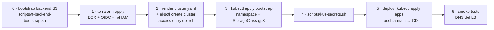

# 004 · Plataforma — plan técnico

## Reparto de herramientas (ADR-0005)
| Herramienta | Gestiona | Estado |
|---|---|---|
| Terraform | ECR ×3, proveedor OIDC GitHub, rol IAM de CI/CD | S3 remoto (`use_lockfile`) |
| eksctl | VPC, EKS, managed node group, addons, access entries | stacks CloudFormation (los crea eksctl) |
| kubectl | todo lo que vive dentro del clúster | git (`deploy/k8s`) |

## Orden de aprovisionamiento

Por qué este orden: el *access entry* de eksctl referencia el ARN del rol → el rol debe existir antes
del clúster. La política del rol referencia el ARN del clúster, que es determinista
(`arn:aws:eks:us-east-1:<acct>:cluster/biblioteca-eks`), así que no hay dependencia circular.

Destrucción (inverso): `kubectl delete -f deploy/k8s/frontend/service.yaml` y `kubectl delete ns biblioteca`
(espera a que el ELB y los EBS se liberen) → `eksctl delete cluster -f ... --wait` → `terraform destroy`.
El bucket de estado se conserva (borrado manual documentado).

## Imágenes
| Imagen | Build | Runtime | Puerto | Usuario |
|---|---|---|---|---|
| service-a | `python:3.12-slim` + uv (`uv sync --frozen --no-dev`) | `python:3.12-slim` con `.venv` copiado | 8000 | 10001 |
| service-b | `node:22-alpine` (`npm ci`, `npm run build`, `npm prune --omit=dev`) | `node:22-alpine` | 3000 | 10001 (`node` reasignado) |
| frontend | `node:22-alpine` (`npm ci`, `npm run build`) | `nginxinc/nginx-unprivileged:1.27-alpine` | 8080 | 101 (nginx) |

Tag = SHA de git (inmutable en ECR). Nunca `latest`.

## eksctl — `deploy/eksctl/cluster.yaml` (estructura esperada)
```yaml
apiVersion: eksctl.io/v1alpha5
kind: ClusterConfig
metadata: {name: biblioteca-eks, region: us-east-1, version: "1.37", tags: {Project: biblioteca}}
availabilityZones: [us-east-1a, us-east-1b]
vpc: {cidr: 10.10.0.0/16, nat: {gateway: Single}, clusterEndpoints: {publicAccess: true, privateAccess: true}}
iam: {withOIDC: true}
accessConfig:
  authenticationMode: API
  bootstrapClusterCreatorAdminPermissions: true
  accessEntries:
    - principalARN: arn:aws:iam::${AWS_ACCOUNT_ID}:role/biblioteca-github-actions
      accessPolicies:
        - policyARN: arn:aws:eks::aws:cluster-access-policy/AmazonEKSEditPolicy
          accessScope: {type: namespace, namespaces: [biblioteca]}
addons:
  - {name: vpc-cni, configurationValues: '{"enableNetworkPolicy":"true"}'}
  - {name: coredns}
  - {name: kube-proxy}
  - {name: aws-ebs-csi-driver, wellKnownPolicies: {ebsCSIController: true}}
managedNodeGroups:
  - {name: ng-default, instanceType: t3.medium, desiredCapacity: 2, minSize: 2, maxSize: 3,
     volumeSize: 30, volumeType: gp3, privateNetworking: true}
```
`${AWS_ACCOUNT_ID}` se sustituye con `scripts/render-cluster-config.sh` → `.harness/cluster.rendered.yaml` (no versionado).

## Terraform — `deploy/terraform/`
```
versions.tf    # terraform >= 1.10 (use_lockfile), aws ~> 6.0
backend.tf     # backend "s3" { use_lockfile = true, encrypt = true }  (bucket/key/region por -backend-config)
backend.hcl.example
providers.tf   # default_tags { Project = "biblioteca", ManagedBy = "terraform" }
variables.tf   # region, project, github_repository, github_branch, cluster_name, ecr_repositories
ecr.tf         # aws_ecr_repository (for_each) + aws_ecr_lifecycle_policy
oidc.tf        # aws_iam_openid_connect_provider (client_id_list = ["sts.amazonaws.com"])
iam.tf         # aws_iam_role + aws_iam_role_policy (data aws_iam_policy_document)
outputs.tf     # ecr_repository_urls, github_actions_role_arn, ecr_registry
tests/*.tftest.hcl  # terraform test con mock_provider "aws" (sin credenciales)
```

## Kubernetes — `deploy/k8s/` (YAML planos)
```
bootstrap/   00-namespace.yaml · 01-storageclass-gp3.yaml          # aplica el operador (cluster-admin)
postgres/    statefulset.yaml · service.yaml · networkpolicy.yaml · secret.example.yaml
mongo/       statefulset.yaml · service.yaml · networkpolicy.yaml · configmap-init.yaml · secret.example.yaml
service-a/   deployment.yaml · service.yaml · configmap.yaml · networkpolicy.yaml
service-b/   deployment.yaml · service.yaml · configmap.yaml · networkpolicy.yaml
frontend/    deployment.yaml · service.yaml (LoadBalancer) · configmap.yaml · networkpolicy.yaml
policies/    default-deny.yaml · allow-dns.yaml
```
El rol de CI (EditPolicy en `biblioteca`) solo aplica lo namespaced; `bootstrap/` lo aplica el operador.

### Presupuesto de recursos (2 × t3.medium ≈ 3.8 vCPU / 6.8 GiB asignables)
| Pod | Réplicas | requests (cpu/mem) | limits (cpu/mem) |
|---|---|---|---|
| service-a | 2 | 100m / 256Mi | 500m / 512Mi |
| service-b | 2 | 100m / 192Mi | 500m / 384Mi |
| frontend | 2 | 50m / 64Mi | 200m / 128Mi |
| postgres | 1 | 250m / 512Mi | 1 / 1Gi |
| mongo | 1 | 250m / 512Mi | 1 / 1Gi |
| **Total requests** | | **1.0 vCPU / 2.0 GiB** | |

## CI/CD
| Workflow | Disparador | Permisos | Pasos |
|---|---|---|---|
| `ci.yml` | `pull_request`, `push` | `contents: read` | toolchain → `make verify` → gitleaks |
| `cd.yml` | `push` a `main`, `workflow_dispatch` | `id-token: write`, `contents: read` | OIDC → ECR login → build/push ×3 (tag SHA) → update-kubeconfig → render → apply → rollout status → smoke |

Variables de repositorio (no secretos): `AWS_REGION`, `AWS_ROLE_ARN`, `EKS_CLUSTER_NAME`, `ECR_REGISTRY`.

## Estrategia de pruebas de plataforma
| Prueba | Herramienta | REQ |
|---|---|---|
| `tests/platform/test_dockerfiles.py` | pytest (parseo de Dockerfile) + hadolint opcional | P-001 |
| `tests/platform/test_compose.py` | pytest + `docker compose config` | P-002 |
| `tests/platform/test_terraform_static.py` | pytest + `python-hcl2` | P-003 |
| `deploy/terraform/tests/*.tftest.hcl` | `terraform test` con `mock_provider` | P-004, P-005 |
| `tests/platform/test_eksctl_config.py` + `eksctl --dry-run` | pytest + eksctl | P-006 |
| `tests/platform/test_k8s_manifests.py` + kubeconform | pytest + kubeconform | P-007…P-012, P-017, P-018 |
| `tests/platform/test_workflows.py` + actionlint opcional | pytest | P-013, P-014 |
| `tests/platform/test_provisioning.py` | pytest (orden en scripts) | P-016 |
| `tests/smoke/test_smoke.py` | pytest + httpx (skip sin `SMOKE_BASE_URL`) | P-015, SYS-001, SYS-003 |
